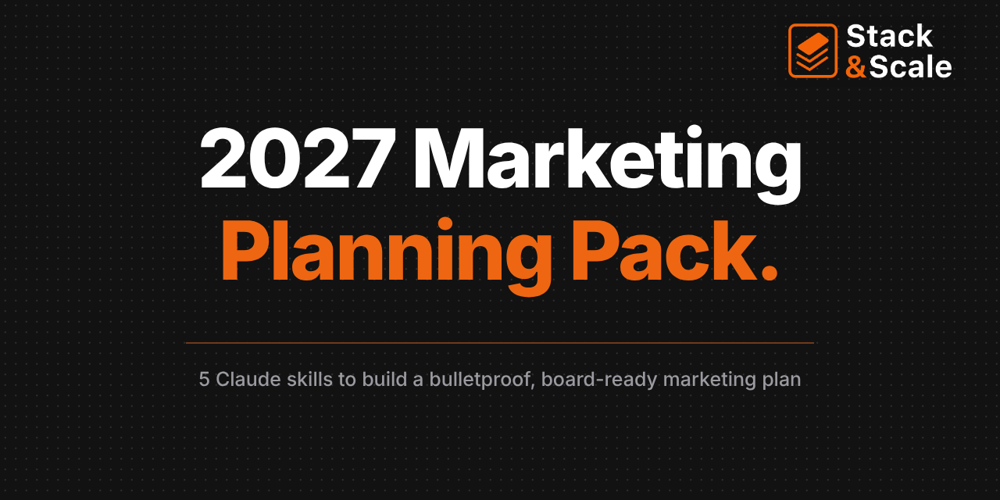

# The Ultimate 2027 Marketing Planning Claude Skill Pack



5 free Claude skills to build a bulletproof marketing plan.

Built for AI-native CMOs at venture-backed, mid-market B2B SaaS companies (roughly $10M to $150M ARR). Use the full planner for your annual plan, or grab one focused skill when you only need one piece.

Made by [Brandon Redlinger](https://stackandscale.ai) at Stack & Scale.

## The 5 skills

| Skill | Use it when | What you get |
|---|---|---|
| `gtm-plan-2027` | You're building your full 2027 plan | One-page plan, full plan doc, live Excel model, OKRs, board deck outline |
| `pipeline-model` | You need the pipeline math, at planning time or mid-year | Inverted funnel with time-based close rates, coverage by quarter, targets by source, capacity check, Excel model |
| `board-red-team` | You have a plan or deck and the board meeting is coming | 21-question scorecard, top 5 fixes, suggested answers |
| `budget-demand-audit` | You want to check where marketing money goes and what it returns | Three budget views, pipe/spend by channel, capture vs. create split, waste audit, reallocation plan |
| `ai-assumptions-check` | Your plan counts on AI savings | Every AI claim sorted into plan, upside, or cut, with a proof point and date |

## How the full planner works

Twelve steps in four stages:

1. Look back: intake, 2026 leaky bucket, strategy before spreadsheet
2. Build the math: ARR bridge, sales capacity, pipeline model
3. Spend it right: demand system, budget, AI-era assumptions
4. Prove it: scenarios, board red-team, outputs and cadence

The four focused skills are the parts people most often need on their own. They share the same references, so the answers match.

## Install

### Claude (web, desktop, mobile)
1. Open the `dist/` folder in this repo and download the zip for each skill you want.
2. In Claude, go to Settings, then Capabilities (or Skills), and upload each zip.
3. Start a chat and say something like "Help me build my 2027 GTM plan" or "Red-team my board deck."

### Claude Code
```
git clone https://github.com/guerrilla2799/gtm-plan-2027.git
cp -r gtm-plan-2027/skills/* ~/.claude/skills/
```

Menu names change, so check Anthropic's help center if you can't find the skills setting.

## Run the model on its own

```
pip install openpyxl
cd skills/gtm-plan-2027
cp templates/inputs.json my_inputs.json   # then edit the numbers
python scripts/build_model.py my_inputs.json gtm_plan_2027.xlsx
```

Open the workbook in Excel or Google Sheets. Blue cells are inputs. Change one and everything updates.

## Worked example

`examples/acme-flow/` is a full run for a made-up $30M ARR company: inputs, the Excel model, the one-page plan, and the board red-team scorecard.

## Where the ideas come from

Much of this is inspired by Dave Kellogg's Kellblog. Over the years, I've borrowed some of his ideas to use in my planning process, like Plan vs. budget, the inverted funnel, time-based close rates, starting coverage over rolling pipeline, the four sources of pipeline, and the board's questions on the marketing budget all come from his writing.

On top of that, the pack adds how to get a plan approved (start with finance, a few themes, three budget buckets, one page) and a modern demand system (one revenue plan, capture then create, a waste audit, and self-reported attribution).

When these ideas pull in different directions, Kellogg's math wins. The skills name the tension out loud.

Kyle Poyar, Emily Kramer, Maja Voje, and others fill gaps.

All of this is in my own words, with links to Kellogg's originals in each skill's `references/sources.md`. Nobody named here is affiliated with or endorses this pack. Go read their stuff. It's better than any summary.

## Repo map

```
skills/gtm-plan-2027/         Full planner (source of truth for shared files)
skills/pipeline-model/        Pipeline math on its own
skills/board-red-team/        Stress-test any plan or deck
skills/budget-demand-audit/   Budget and demand mix review
skills/ai-assumptions-check/  Check AI savings claims
dist/                         One zip per skill, ready to upload
examples/acme-flow/           Worked example
tools/sync_and_package.py     Copies shared files into each skill and rebuilds the zips
```

Contributing: edit shared references in `skills/gtm-plan-2027/`, then run `python tools/sync_and_package.py`.

## License

MIT for the code and original writing. Ideas from the people credited above stay theirs. Kellblog materials are under their own Creative Commons license and aren't copied here.

## Feedback

Open an issue or find me on LinkedIn. If you use it for your plan, I'd love to hear what broke.
